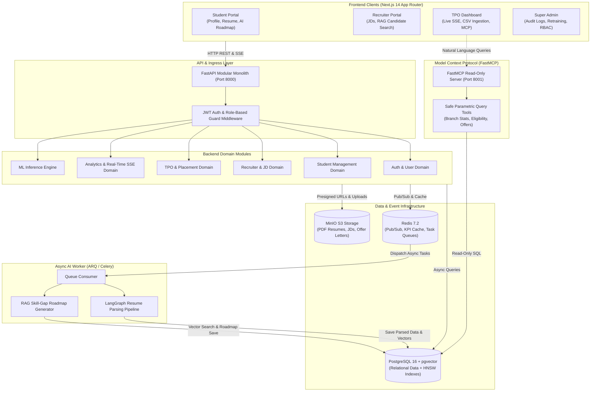

# 🎓 Student Placement Analytics & Career Intelligence Platform

[](https://fastapi.tiangolo.com/)
[](https://nextjs.org/)
[](https://github.com/pgvector/pgvector)
[](https://redis.io/)
[](https://github.com/langchain-ai/langgraph)
[](https://github.com/jlowin/fastmcp)
[](https://xgboost.readthedocs.io/)

A production-grade, AI-native placement intelligence and analytics platform designed for engineering colleges (~3,000+ students). Built with a **Modular Monolith + Async AI Worker** architecture, real-time Server-Sent Events (SSE) dashboards, automated LangGraph resume parsing, XGBoost-based placement and CTC prediction, and safe FastMCP-driven natural language queries for Training & Placement Officers (TPO).

---

## 📑 Table of Contents
1. [Core Features](#-core-features)
2. [System Architecture](#-system-architecture)
3. [Technology Stack](#-technology-stack)
4. [Role-Based Access Control (RBAC)](#-role-based-access-control-rbac)
5. [Core AI & Analytics Workflows](#-core-ai--analytics-workflows)
6. [Repository Structure](#-repository-structure)
7. [Detailed Documentation Suite](#-detailed-documentation-suite)
8. [Quickstart & Development](#-quickstart--development)
9. [Future Extensibility Roadmap](#-future-extensibility-roadmap)

---

## 🌟 Core Features

- **⚡ Real-Time TPO Dashboard (SSE):** Instant updates for college-wide KPIs (Placement %, Branch breakdown, CTC percentiles, Active offers) powered by Redis Pub/Sub and Server-Sent Events without manual page refresh.
- **📄 Async LangGraph Resume Parser:** Non-blocking pipeline extracting structured skills, projects, CGPA, and certifications from uploaded PDF resumes into Postgres + generating HNSW vector embeddings in `pgvector`.
- **🤖 RAG Skill-Gap Roadmap Generator:** Tailored 4-week preparation plan comparing student resumes against target Job Descriptions and previously placed senior profiles.
- **📈 ML Placement & CTC Predictor:** Machine learning models (XGBoost Classifier + Regressor) trained on academic history, backlogs, technical aptitude, and internship experience to predict placement odds and CTC LPA bands.
- **🔌 FastMCP Read-Only Server:** Secure Model Context Protocol server exposing parameterized, read-only analytics queries to AI assistants (e.g. Claude Desktop, internal agents) without exposing raw SQL or direct DB credentials.
- **📁 Bulk Student Ingestion:** Asynchronous CSV/Excel ingestion pipeline for 3,000+ student profiles with validation and auto-account provisioning.

---

## 🏛️ System Architecture



---

## 🛠️ Technology Stack

| Domain | Technology | Purpose |
|---|---|---|
| **Frontend** | Next.js 14 (App Router, TypeScript) | Modern UI with Server Components & dynamic client dashboards |
| **Styling & UI** | Tailwind CSS + Shadcn UI | Accessible, clean, dark/light mode responsive components |
| **Data Visualization**| Recharts | Interactive placement analytics charts, CTC histograms, branch heatmaps |
| **Backend API** | FastAPI (Python 3.11+) | High-throughput async modular monolith |
| **ORM & Migrations** | Async SQLAlchemy 2.0 + Alembic | Type-safe async ORM with automated schema migrations |
| **Database** | PostgreSQL 16 + `pgvector` | Unified storage for relational records and 1536-dim vector embeddings |
| **Cache & Real-Time** | Redis 7.2 (Pub/Sub & Task Queue) | SSE live event distribution, KPI caching, task queuing |
| **Object Storage** | MinIO (S3-compatible) | Self-hosted S3 object store for resumes, offer letters, and JDs |
| **Async Task Worker** | ARQ / Celery with Redis | Background processing for PDFs, LangGraph workflows, and bulk imports |
| **AI Workflows & RAG**| LangGraph + LangChain | State machine resume extraction & RAG skill gap roadmap generation |
| **Tool Protocol** | FastMCP | Model Context Protocol server exposing read-only analytical queries |
| **Machine Learning** | XGBoost + Scikit-Learn + Joblib | Placement probability classification & CTC band regression |
| **Containerization** | Docker + Docker Compose | One-command local development setup across all services |

---

## 🔐 Role-Based Access Control (RBAC)

The platform enforces strict role boundaries verified at the API router layer via FastAPI dependencies (`require_role`):

| Feature / Resource | Student | Recruiter | TPO | Super Admin |
|---|:---:|:---:|:---:|:---:|
| **Manage Own Profile & Resume** | ✅ | ❌ | ❌ | ❌ |
| **View Own Placement Probability & Roadmap** | ✅ | ❌ | ❌ | ❌ |
| **Apply to Eligible Placement Drives** | ✅ | ❌ | ❌ | ❌ |
| **Post Job Descriptions (JDs)** | ❌ | ✅ | ❌ | ❌ |
| **View Applicants for Own Drives** | ❌ | ✅ | ❌ | ❌ |
| **Semantic RAG Search on Applicants** | ❌ | ✅ | ❌ | ❌ |
| **Full College Placement Analytics Dashboard** | ❌ | ❌ | ✅ | ✅ |
| **Bulk Student CSV Upload (3,000+ students)** | ❌ | ❌ | ✅ | ✅ |
| **Approve Placement Drives** | ❌ | ❌ | ✅ | ✅ |
| **Mark Students as "Placed" (Company + CTC)** | ❌ | ❌ | ✅ | ✅ |
| **Natural Language AI Query via FastMCP** | ❌ | ❌ | ✅ | ✅ |
| **Approve Recruiter/TPO Accounts & Manage Roles** | ❌ | ❌ | ❌ | ✅ |
| **Trigger ML Retraining & Inspect Audit Logs** | ❌ | ❌ | ❌ | ✅ |

---

## ⚡ Core AI & Analytics Workflows

### 1. Async LangGraph Resume Parsing
```
[Student Uploads PDF] 
       │
       ▼
[Saved to MinIO S3 & Event Pushed to Redis]
       │
       ▼
[Worker LangGraph State Machine]
   ├── Node 1: Extract text using PyMuPDF
   ├── Node 2: LLM Structured Extraction (Skills, Projects, CGPA, Certifications)
   ├── Node 3: Verification & Pydantic Schema Validation
   └── Node 4: Save JSONB to PostgreSQL + Generate Vector Embeddings (pgvector)
```

### 2. Real-Time TPO Analytics (SSE Engine)
```
[TPO Marks Student as Placed (Offer + CTC)]
       │
       ▼
[Transaction Committed to PostgreSQL]
       │
       ▼
[Invalidate Redis KPI Cache & Publish to 'tpo:live_analytics']
       │
       ▼
[FastAPI SSE Stream pushes JSON payload to connected TPO/Admin Dashboards]
```

### 3. RAG Skill-Gap Roadmap Generator
```
[Student selects Target Company / Drive]
       │
       ▼
[pgvector Cosine Search: Target JD + Placed Seniors' Profiles]
       │
       ▼
[LangGraph Agent: Analyzes Missing Skills, Core Projects & LeetCode focus]
       │
       ▼
[Generates 4-Week Actionable Sprint Plan with learning resources]
```

---

## 📂 Repository Structure

```text
AIML_student_placement/
├── docker-compose.yml         # Local stack: Postgres(pgvector), Redis, MinIO, Backend, Worker, MCP, Frontend
├── .env.example               # Unified environment variables template
├── README.md                  # This file
│
├── docs/                      # Comprehensive Architecture & Design Docs
│   ├── ARCHITECTURE.md        # Deep dive into Modular Monolith & async patterns
│   ├── DATABASE_SCHEMA.md     # Relational + pgvector DDL, indexes & ER diagram
│   ├── API_SPECIFICATION.md   # Complete REST endpoints, payloads & SSE contracts
│   ├── AI_AGENT_WORKFLOWS.md  # LangGraph machines, RAG architecture & FastMCP tools
│   └── SETUP_GUIDE.md         # Step-by-step local setup, Docker & migrations
│
├── backend/                   # FastAPI Modular Monolith (Port 8000)
│   ├── app/
│   │   ├── core/              # Config, Database, Redis, Security, S3, Events
│   │   ├── common/            # Shared pagination, exceptions, formatters
│   │   ├── models/            # SQLAlchemy declarative models
│   │   └── modules/           # auth, students, recruiters, drives, tpo, analytics, ml
│   └── alembic/               # Async DB migrations
│
├── worker/                    # Async Background Worker (ARQ / Celery)
│   ├── workflows/             # LangGraph Resume Parser & RAG Skill-Gap state machines
│   ├── tasks/                 # Background task handlers
│   └── rag/                   # pgvector similarity search & embedding utilities
│
├── mcp_server/                # FastMCP Read-Only Analytics Server (Port 8001)
│   ├── server.py              # FastMCP runner
│   └── tools/                 # Branch stats, eligibility filters, offer summaries
│
├── ml/                        # ML Pipelines & Model Artifacts
│   ├── pipelines/             # XGBoost classification & regression training scripts
│   └── saved_models/          # Exported .joblib models & feature encoders
│
├── scripts/                   # Seeding & Utility Scripts
│   ├── generate_synthetic_3000.py # 3,000 realistic Indian student profile generator
│   ├── seed_database.py       # Direct DB seeder
│   └── init_minio.py          # S3 bucket initializer
│
└── frontend/                  # Next.js 14+ App Router (Port 3000)
    └── src/
        ├── app/               # (auth), (dashboard)/student, /recruiter, /tpo, /admin
        ├── components/        # Shadcn UI primitives, Recharts widgets, SSE status
        ├── hooks/             # useSSE, useAuth, useApi
        └── lib/               # API clients & utilities
```

---

## 📚 Detailed Documentation Suite

For comprehensive deep dives into each subsystem, refer to the documentation in [`/docs`](docs/):
- 📘 [**Architecture Document**](docs/ARCHITECTURE.md): System design, modular boundaries, event bus, and scaling considerations.
- 🗄️ [**Database & pgvector Schema**](docs/DATABASE_SCHEMA.md): Complete DDL, HNSW index configuration, and ER diagrams.
- 📡 [**API Specification**](docs/API_SPECIFICATION.md): Detailed REST endpoints, request/response bodies, and SSE events.
- 🤖 [**AI Workflows & FastMCP Guide**](docs/AI_AGENT_WORKFLOWS.md): LangGraph state graph schemas and MCP tool specifications.
- 🚀 [**Developer Setup Guide**](docs/SETUP_GUIDE.md): Local environment setup, Docker Compose, and synthetic seeding.

---

## 🚀 Quickstart & Development

### Prerequisites
- [Docker](https://docs.docker.com/get-docker/) & Docker Compose
- Python 3.11+
- Node.js 18+ (LTS) & pnpm / npm

### 1. Clone & Configure Environment
```bash
git clone <your-github-org-repo-url>
cd AIML_student_placement
cp .env.example .env
```

### 2. Start Core Infrastructure with Docker Compose
```bash
docker compose up -d postgres redis minio
```

### 3. Initialize Database & Seed Synthetic 3,000 Students
```bash
# Apply Alembic Migrations
cd backend
alembic upgrade head

# Generate and seed 3,000 realistic student profiles
cd ../scripts
python generate_synthetic_3000.py
python seed_database.py
```

### 4. Run Full Stack
```bash
docker compose up --build
```
- **Frontend Portal:** [http://localhost:3000](http://localhost:3000)
- **FastAPI Interactive Docs:** [http://localhost:8000/docs](http://localhost:8000/docs)
- **MinIO Console:** [http://localhost:9001](http://localhost:9001) (`minioadmin` / `minioadmin`)
- **FastMCP Server:** [http://localhost:8001](http://localhost:8001)

---

## 🔮 Future Extensibility Roadmap

The modular monolith is structured so that adding any new module takes zero refactoring of existing modules:
- [ ] **Alumni Mentorship Network (`modules/alumni`):** Connect unplaced students with placed alumni in similar roles.
- [ ] **AI Mock Interview Simulator (`modules/interviews`):** Voice/video real-time mock interviews with scoring.
- [ ] **Automated Alerts Service (`modules/notifications`):** Celery tasks sending WhatsApp and Email alerts for upcoming drives.
- [ ] **Company Review & Interview Experiences (`modules/reviews`):** Anonymous feedback and interview questions shared by seniors.

---

## 📄 License
This project is licensed under the MIT License.
