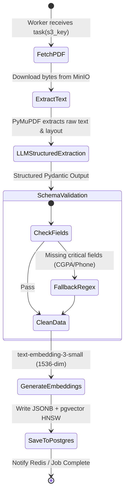
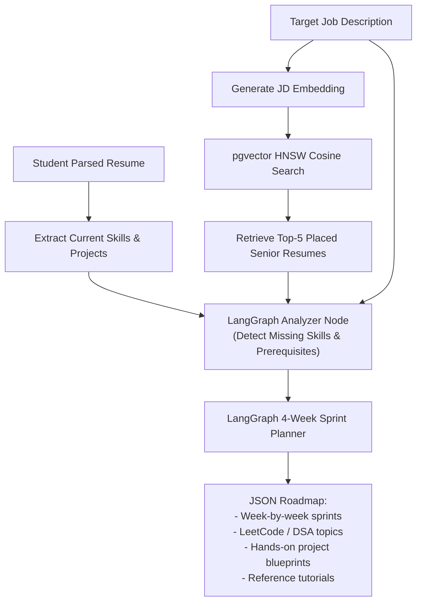

# 🤖 AI Agent Workflows & FastMCP Specification

This document details the Agentic AI workflows, LangGraph state machines, pgvector similarity retrievals, and FastMCP read-only tools.

---

## 1. Async LangGraph Resume Parser

The resume parsing pipeline is implemented as a deterministic LangGraph State Machine executed asynchronously by background workers (ARQ / Celery).

### State Machine Architecture



### LangGraph State Schema (`ResumeParserState`)
```python
from typing import TypedDict, Optional, List, Dict, Any

class ResumeParserState(TypedDict):
    s3_key: str
    student_id: str
    raw_pdf_bytes: Optional[bytes]
    raw_text: str
    parsed_data: Optional[Dict[str, Any]]
    validation_errors: List[str]
    embeddings: Optional[List[float]]
    success: bool
```

### Pydantic Extraction Model
```python
from pydantic import BaseModel, Field
from typing import List, Optional

class ParsedProject(BaseModel):
    title: str
    description: str
    technologies: List[str]
    github_link: Optional[str] = None

class ParsedInternship(BaseModel):
    company: str
    role: str
    duration_months: int
    key_contributions: List[str]

class ParsedResumeSchema(BaseModel):
    full_name: Optional[str]
    phone: Optional[str]
    linkedin_url: Optional[str]
    github_url: Optional[str]
    cgpa: Optional[float] = Field(None, ge=0.0, le=10.0)
    skills: List[str] = Field(default_factory=list)
    projects: List[ParsedProject] = Field(default_factory=list)
    internships: List[ParsedInternship] = Field(default_factory=list)
    certifications: List[str] = Field(default_factory=list)
```

---

## 2. RAG Skill-Gap Roadmap Generator

When a student targets a specific Placement Drive or Company Role, the LangGraph RAG Agent analyzes the student's current parsed skills and compares them against:
1. The target Job Description (JD).
2. Anonymized profiles of previously placed students who secured offers at that company or similar CTC bands.



---

## 3. FastMCP Read-Only Server (Model Context Protocol)

The FastMCP server exposes safe, parameterized, read-only tools to AI assistants (such as the TPO Copilot) to query live placement analytics without exposing raw SQL or direct database connections.

### Tool 1: `get_branch_placement_stats`
- **Description:** Returns aggregate placement counts, percentages, and average CTC for a given engineering branch.
- **Parameters:**
  - `branch` (string, required): e.g., `'Computer Science'`, `'Information Technology'`, `'ECE'`
- **Output:**
```json
{
  "branch": "Computer Science",
  "total_students": 600,
  "placed_students": 580,
  "placement_percentage": 96.67,
  "average_ctc_lpa": 11.2,
  "highest_ctc_lpa": 44.0,
  "median_ctc_lpa": 9.5
}
```

### Tool 2: `find_eligible_students`
- **Description:** Queries students meeting minimum CGPA, maximum backlogs, and specific required technical skills.
- **Parameters:**
  - `min_cgpa` (float, default 6.0)
  - `max_backlogs` (int, default 0)
  - `required_skills` (list of strings, e.g. `["React", "Docker"]`)
- **Output:** List of student summaries with contact and roll number.

### Tool 3: `get_unplaced_high_cgpa_students`
- **Description:** Highlights students with CGPA above a specific threshold who remain unplaced, alerting TPO for targeted placement intervention.
- **Parameters:**
  - `threshold_cgpa` (float, default 8.0)
- **Output:** List of top unplaced candidates.

### Tool 4: `get_company_offer_summary`
- **Description:** Summarizes all offers made across companies during the current placement season, ordered by total recruits.
- **Output:** Array of companies with total offers made and average CTC.
