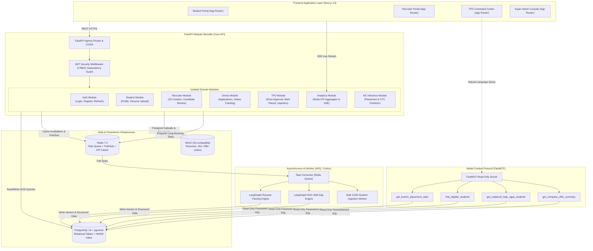
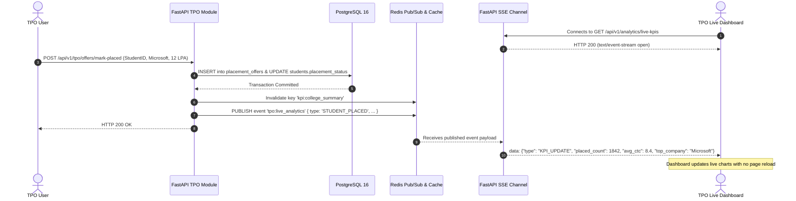

# 🏛️ System Architecture Design Document

**Project:** Student Placement Analytics & Career Intelligence Platform  
**Architecture Style:** Modular Monolith + Asynchronous AI Worker  
**Target Scale:** Single University / College (~3,000 active students, ~200 placement drives/year)

---

## 1. Architectural Philosophy & Strategy

Modern enterprise software often falls into the trap of premature microservices: distributed transactions, network latency, complex observability overhead, and high deployment costs. For an academic institution of ~3,000 students:
1. **Core API is a Modular Monolith:** A single FastAPI deployment with strictly bounded domain contexts (`auth`, `students`, `recruiters`, `tpo`, `drives`, `analytics`, `ml`). Each domain owns its models, schemas, services, and routers.
2. **Heavy Computing is Offloaded to an Asynchronous Worker:** Heavy operations (extracting text from complex multi-page PDF resumes, running LLM structured extraction, generating 1536-dimensional embeddings, and bulk CSV ingestion) run on an independent worker (ARQ / Celery) backed by Redis.
3. **Database Unification with `pgvector`:** Instead of maintaining a separate vector database (e.g., Pinecone/Milvus) alongside a relational database, PostgreSQL 16 with the `pgvector` extension serves both relational and vector data in a single transactional engine.
4. **Decoupled Event-Driven Bus via Redis Pub/Sub:** Real-time metrics and notifications communicate through internal domain events, ensuring loose coupling between modules.

---

## 2. High-Level System Architecture Diagram



---

## 3. Domain Modules & Internal Communication

Each domain inside `backend/app/modules/` follows a standardized layered pattern:
```text
module/
├── router.py       # FastAPI APIRouter exposing versioned HTTP endpoints
├── schemas.py      # Pydantic v2 validation models for Request and Response
├── service.py      # Business logic orchestration & external client calls
└── repository.py   # Pure database queries using Async SQLAlchemy 2.0
```

### Module Responsibilities:
1. **`auth`**: Handles password hashing (`bcrypt`), JWT token generation, refresh tokens, role resolution, and user status.
2. **`students`**: Personal profile data, academic records, resume S3 key linking, viewing placement status.
3. **`recruiters`**: Company information, job description (JD) postings, viewing shortlisted students for posted drives.
4. **`drives`**: Placement drives lifecycle (draft -> pending approval -> active -> completed), student application submission, eligibility verification.
5. **`tpo`**: Drive approvals, bulk student roster imports, marking student as placed with verified CTC.
6. **`analytics`**: Real-time KPI aggregation (Placement %, average CTC, branch-wise placements), caching metrics in Redis, streaming live updates via Server-Sent Events (SSE).
7. **`ml`**: Real-time inference using serialized XGBoost pipelines (`placement_classifier.joblib`, `ctc_regressor.joblib`).

---

## 4. Real-Time Data Flow: Server-Sent Events (SSE)

When a placement event occurs (e.g., a student gets an offer of 12 LPA from Microsoft):



---

## 5. Security & Isolation Architecture

1. **Defense in Depth:**
   - Transport encryption (TLS) on all external ingress.
   - JWT tokens containing `sub` (User UUID) and `role` (`student`, `recruiter`, `tpo`, `admin`).
   - Role verification occurs at the FastAPI route dependency level via `require_role(["tpo", "admin"])`.
2. **Data Isolation (Multi-Tenancy within Single College):**
   - Students can only view their own profile, prediction, and roadmap.
   - Recruiters can only access student profiles who actively applied to their drives.
   - Resumes stored in MinIO are private; the frontend receives time-limited (15-minute) presigned URLs.
3. **Audit Logging:**
   - Sensitive administrative operations (drive approvals, marking offers, bulk uploads) automatically generate an immutable record in `audit_logs`.

---

## 6. Scalability & Extensibility Roadmap

The system is designed with explicit hooks for future extensions:

| Future Extension | Integration Point | Architecture Impact |
|---|---|---|
| **Alumni Mentorship** | New module `modules/alumni/` | Add `alumni_profiles` table, reuse `pgvector` for skill-based mentor matching |
| **AI Mock Interview** | New module `modules/mock_interviews/` | Integrate WebRTC / Whisper speech-to-text in worker, store feedback in Postgres |
| **WhatsApp/Email Alerts** | Subscribe to Redis Event Bus | New consumer daemon reading from `tpo:live_analytics` and dispatching Twilio/SendGrid alerts |
| **Hackathon & Contest Tracker** | New module `modules/contests/` | LeetCode/Codeforces API scraping tasks in background worker |
