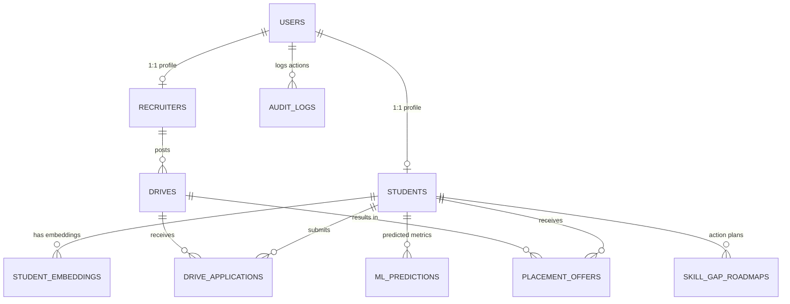

# 🗄️ Database & pgvector Schema Specification

**Database Engine:** PostgreSQL 16  
**Extensions Required:** `uuid-ossp`, `vector` (pgvector v0.7+)  
**Target Workload:** ~3,000 active students, ~200 placement drives, 1536-dimensional OpenAI / 384-dimensional HuggingFace embeddings.

---

## 1. Entity-Relationship Overview



---

## 2. PostgreSQL DDL Statements

```sql
-- ============================================================================
-- 1. EXTENSIONS
-- ============================================================================
CREATE EXTENSION IF NOT EXISTS "uuid-ossp";
CREATE EXTENSION IF NOT EXISTS "vector";

-- ============================================================================
-- 2. ENUM TYPES
-- ============================================================================
CREATE TYPE user_role AS ENUM ('student', 'recruiter', 'tpo', 'admin');
CREATE TYPE placement_status_enum AS ENUM ('unplaced', 'placed', 'opted_out');
CREATE TYPE drive_status_enum AS ENUM ('draft', 'pending_approval', 'active', 'completed', 'cancelled');
CREATE TYPE application_status_enum AS ENUM ('applied', 'shortlisted', 'interview_scheduled', 'offered', 'rejected');
CREATE TYPE offer_status_enum AS ENUM ('offered', 'accepted', 'rejected');

-- ============================================================================
-- 3. USERS TABLE
-- ============================================================================
CREATE TABLE users (
    id UUID PRIMARY KEY DEFAULT uuid_generate_v4(),
    email VARCHAR(255) UNIQUE NOT NULL,
    hashed_password VARCHAR(255) NOT NULL,
    role user_role NOT NULL,
    is_active BOOLEAN NOT NULL DEFAULT TRUE,
    is_verified BOOLEAN NOT NULL DEFAULT FALSE,
    created_at TIMESTAMP WITH TIME ZONE NOT NULL DEFAULT CURRENT_TIMESTAMP,
    updated_at TIMESTAMP WITH TIME ZONE NOT NULL DEFAULT CURRENT_TIMESTAMP
);

CREATE INDEX idx_users_email ON users(email);
CREATE INDEX idx_users_role ON users(role);

-- ============================================================================
-- 4. STUDENTS TABLE
-- ============================================================================
CREATE TABLE students (
    id UUID PRIMARY KEY DEFAULT uuid_generate_v4(),
    user_id UUID UNIQUE NOT NULL REFERENCES users(id) ON DELETE CASCADE,
    roll_number VARCHAR(50) UNIQUE NOT NULL,
    full_name VARCHAR(150) NOT NULL,
    branch VARCHAR(100) NOT NULL, -- e.g., 'Computer Science', 'Information Technology', 'ECE', 'Mechanical'
    batch_year INT NOT NULL,       -- e.g., 2025, 2026
    cgpa NUMERIC(4, 2) NOT NULL CHECK (cgpa >= 0.00 AND cgpa <= 10.00),
    active_backlogs INT NOT NULL DEFAULT 0 CHECK (active_backlogs >= 0),
    history_of_backlogs INT NOT NULL DEFAULT 0 CHECK (history_of_backlogs >= 0),
    phone VARCHAR(20),
    linkedin_url VARCHAR(255),
    github_url VARCHAR(255),
    resume_s3_key VARCHAR(500),
    resume_uploaded_at TIMESTAMP WITH TIME ZONE,
    parsed_resume JSONB,          -- Extracted skills, projects, certifications, internships
    placement_status placement_status_enum NOT NULL DEFAULT 'unplaced',
    is_eligible_for_placements BOOLEAN NOT NULL DEFAULT TRUE,
    created_at TIMESTAMP WITH TIME ZONE NOT NULL DEFAULT CURRENT_TIMESTAMP,
    updated_at TIMESTAMP WITH TIME ZONE NOT NULL DEFAULT CURRENT_TIMESTAMP
);

CREATE INDEX idx_students_roll_number ON students(roll_number);
CREATE INDEX idx_students_branch ON students(branch);
CREATE INDEX idx_students_cgpa ON students(cgpa);
CREATE INDEX idx_students_placement_status ON students(placement_status);
CREATE INDEX idx_students_parsed_resume ON students USING gin (parsed_resume);

-- ============================================================================
-- 5. STUDENT EMBEDDINGS (pgvector)
-- ============================================================================
CREATE TABLE student_embeddings (
    id UUID PRIMARY KEY DEFAULT uuid_generate_v4(),
    student_id UUID NOT NULL REFERENCES students(id) ON DELETE CASCADE,
    embedding_type VARCHAR(50) NOT NULL, -- 'resume_full', 'skills_projects'
    embedding vector(1536) NOT NULL,     -- 1536-dim (compatible with OpenAI text-embedding-3-small)
    metadata JSONB DEFAULT '{}'::jsonb,
    created_at TIMESTAMP WITH TIME ZONE NOT NULL DEFAULT CURRENT_TIMESTAMP
);

CREATE INDEX idx_student_embeddings_student_id ON student_embeddings(student_id);

-- HNSW Cosine similarity index for fast semantic applicant search
CREATE INDEX idx_student_embeddings_hnsw ON student_embeddings 
USING hnsw (embedding vector_cosine_ops)
WITH (m = 16, ef_construction = 64);

-- ============================================================================
-- 6. RECRUITERS TABLE
-- ============================================================================
CREATE TABLE recruiters (
    id UUID PRIMARY KEY DEFAULT uuid_generate_v4(),
    user_id UUID UNIQUE NOT NULL REFERENCES users(id) ON DELETE CASCADE,
    company_name VARCHAR(150) NOT NULL,
    industry VARCHAR(100),
    website VARCHAR(255),
    company_logo_url VARCHAR(500),
    contact_person VARCHAR(100),
    contact_phone VARCHAR(20),
    is_approved BOOLEAN NOT NULL DEFAULT FALSE,
    created_at TIMESTAMP WITH TIME ZONE NOT NULL DEFAULT CURRENT_TIMESTAMP,
    updated_at TIMESTAMP WITH TIME ZONE NOT NULL DEFAULT CURRENT_TIMESTAMP
);

CREATE INDEX idx_recruiters_company_name ON recruiters(company_name);

-- ============================================================================
-- 7. PLACEMENT DRIVES TABLE
-- ============================================================================
CREATE TABLE drives (
    id UUID PRIMARY KEY DEFAULT uuid_generate_v4(),
    recruiter_id UUID NOT NULL REFERENCES recruiters(id) ON DELETE CASCADE,
    title VARCHAR(200) NOT NULL,
    role_name VARCHAR(150) NOT NULL,
    job_description TEXT NOT NULL,
    jd_embedding vector(1536),           -- Vector representation of the job description
    min_cgpa NUMERIC(4, 2) NOT NULL DEFAULT 6.00,
    max_backlogs INT NOT NULL DEFAULT 0,
    allowed_branches TEXT[] NOT NULL,     -- Array: ['Computer Science', 'Information Technology']
    ctc_min_lpa NUMERIC(6, 2) NOT NULL,
    ctc_max_lpa NUMERIC(6, 2) NOT NULL,
    job_location VARCHAR(150) NOT NULL,
    drive_date DATE NOT NULL,
    registration_deadline TIMESTAMP WITH TIME ZONE NOT NULL,
    status drive_status_enum NOT NULL DEFAULT 'draft',
    approved_by_tpo_id UUID REFERENCES users(id),
    created_at TIMESTAMP WITH TIME ZONE NOT NULL DEFAULT CURRENT_TIMESTAMP,
    updated_at TIMESTAMP WITH TIME ZONE NOT NULL DEFAULT CURRENT_TIMESTAMP
);

CREATE INDEX idx_drives_recruiter_id ON drives(recruiter_id);
CREATE INDEX idx_drives_status ON drives(status);
CREATE INDEX idx_drives_deadline ON drives(registration_deadline);

-- HNSW Index for matching JDs against students
CREATE INDEX idx_drives_jd_embedding_hnsw ON drives 
USING hnsw (jd_embedding vector_cosine_ops)
WITH (m = 16, ef_construction = 64);

-- ============================================================================
-- 8. DRIVE APPLICATIONS TABLE
-- ============================================================================
CREATE TABLE drive_applications (
    id UUID PRIMARY KEY DEFAULT uuid_generate_v4(),
    drive_id UUID NOT NULL REFERENCES drives(id) ON DELETE CASCADE,
    student_id UUID NOT NULL REFERENCES students(id) ON DELETE CASCADE,
    status application_status_enum NOT NULL DEFAULT 'applied',
    match_score NUMERIC(5, 2),            -- Vector similarity / algorithmic match score (0-100%)
    rejection_reason TEXT,
    applied_at TIMESTAMP WITH TIME ZONE NOT NULL DEFAULT CURRENT_TIMESTAMP,
    updated_at TIMESTAMP WITH TIME ZONE NOT NULL DEFAULT CURRENT_TIMESTAMP,
    UNIQUE (drive_id, student_id)
);

CREATE INDEX idx_applications_drive_student ON drive_applications(drive_id, student_id);
CREATE INDEX idx_applications_status ON drive_applications(status);

-- ============================================================================
-- 9. PLACEMENT OFFERS TABLE
-- ============================================================================
CREATE TABLE placement_offers (
    id UUID PRIMARY KEY DEFAULT uuid_generate_v4(),
    drive_id UUID REFERENCES drives(id) ON DELETE SET NULL,
    student_id UUID NOT NULL REFERENCES students(id) ON DELETE CASCADE,
    company_name VARCHAR(150) NOT NULL,
    ctc_lpa NUMERIC(6, 2) NOT NULL CHECK (ctc_lpa > 0),
    offer_letter_s3_key VARCHAR(500),
    offer_date DATE NOT NULL DEFAULT CURRENT_DATE,
    status offer_status_enum NOT NULL DEFAULT 'offered',
    is_on_campus BOOLEAN NOT NULL DEFAULT TRUE,
    created_at TIMESTAMP WITH TIME ZONE NOT NULL DEFAULT CURRENT_TIMESTAMP,
    updated_at TIMESTAMP WITH TIME ZONE NOT NULL DEFAULT CURRENT_TIMESTAMP
);

CREATE INDEX idx_offers_student_id ON placement_offers(student_id);
CREATE INDEX idx_offers_company ON placement_offers(company_name);
CREATE INDEX idx_offers_ctc ON placement_offers(ctc_lpa);

-- ============================================================================
-- 10. ML PREDICTIONS TABLE
-- ============================================================================
CREATE TABLE ml_predictions (
    id UUID PRIMARY KEY DEFAULT uuid_generate_v4(),
    student_id UUID NOT NULL REFERENCES students(id) ON DELETE CASCADE,
    placement_probability NUMERIC(5, 2) NOT NULL CHECK (placement_probability >= 0 AND placement_probability <= 100),
    predicted_ctc_min NUMERIC(6, 2) NOT NULL,
    predicted_ctc_max NUMERIC(6, 2) NOT NULL,
    predicted_ctc_median NUMERIC(6, 2) NOT NULL,
    top_features JSONB NOT NULL DEFAULT '{}'::jsonb,
    model_version VARCHAR(50) NOT NULL,
    created_at TIMESTAMP WITH TIME ZONE NOT NULL DEFAULT CURRENT_TIMESTAMP
);

CREATE INDEX idx_ml_predictions_student_id ON ml_predictions(student_id);

-- ============================================================================
-- 11. SKILL GAP ROADMAPS TABLE
-- ============================================================================
CREATE TABLE skill_gap_roadmaps (
    id UUID PRIMARY KEY DEFAULT uuid_generate_v4(),
    student_id UUID NOT NULL REFERENCES students(id) ON DELETE CASCADE,
    target_drive_id UUID REFERENCES drives(id) ON DELETE SET NULL,
    target_role VARCHAR(150) NOT NULL,
    missing_skills TEXT[] NOT NULL,
    recommended_projects JSONB NOT NULL DEFAULT '[]'::jsonb,
    weekly_roadmap JSONB NOT NULL DEFAULT '{}'::jsonb,
    created_at TIMESTAMP WITH TIME ZONE NOT NULL DEFAULT CURRENT_TIMESTAMP
);

CREATE INDEX idx_roadmaps_student ON skill_gap_roadmaps(student_id);

-- ============================================================================
-- 12. AUDIT LOGS TABLE
-- ============================================================================
CREATE TABLE audit_logs (
    id UUID PRIMARY KEY DEFAULT uuid_generate_v4(),
    user_id UUID REFERENCES users(id) ON DELETE SET NULL,
    action VARCHAR(100) NOT NULL,        -- 'APPROVE_DRIVE', 'MARK_PLACED', 'BULK_CSV_UPLOAD'
    entity_name VARCHAR(50) NOT NULL,    -- 'drives', 'placement_offers', 'students'
    entity_id UUID,
    ip_address VARCHAR(45),
    details JSONB NOT NULL DEFAULT '{}'::jsonb,
    created_at TIMESTAMP WITH TIME ZONE NOT NULL DEFAULT CURRENT_TIMESTAMP
);

CREATE INDEX idx_audit_logs_user_id ON audit_logs(user_id);
CREATE INDEX idx_audit_logs_action ON audit_logs(action);
CREATE INDEX idx_audit_logs_created ON audit_logs(created_at);
```

---

## 3. Vector Index Configuration & Optimization

We leverage the **HNSW (Hierarchical Navigable Small World)** indexing mechanism from `pgvector`:
- **Distance Metric:** Cosine Distance (`vector_cosine_ops`)
  $$ \text{Distance} = 1 - \frac{u \cdot v}{\|u\| \|v\|} $$
- **`m = 16`**: Max number of bidirectional links per element per layer.
- **`ef_construction = 64`**: Size of dynamic candidate list during graph construction (ensures high recall > 98% with low build time).
- **Sub-millisecond query time:** For 3,000 students × 2 embeddings each (~6,000 vectors), HNSW retrieval completes in **< 3ms**.
